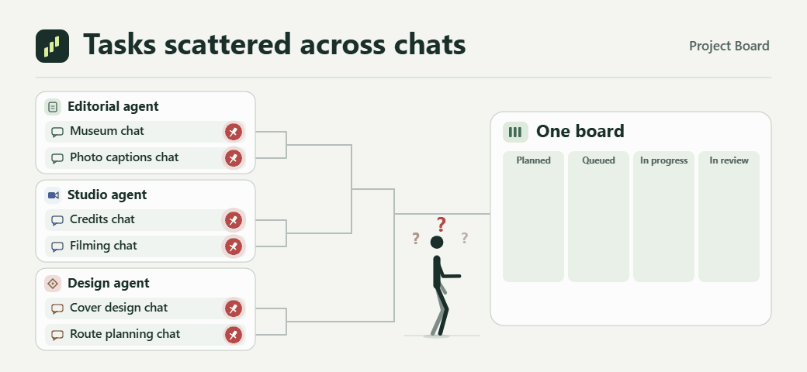

# Project Board

[Русский](README.md) · [User guide](docs/guide.en.md)

Project Board is a local Kanban board for tasks from chats. It looks for tasks in Codex history and accepts tasks sent by connected assistants. A card can keep the task details and a link to the original chat.

[Download for Windows, macOS and Linux](https://github.com/Des0l/project-board/releases/latest) · [Try the demo](#try-the-demo)

## Download and run

Extract the archive for your system to a folder you can write to.

| Platform | Launch |
| --- | --- |
| Windows | Open `ProjectBoard.exe` or `Open-board.cmd`. |
| macOS | Open `Open-board.command` in Finder. |
| Linux | Run `sh Open-board.sh` from the app folder. |

To run from source, use Node.js 22.13 or later and run `npm run open` from the repository. [Setup details](docs/guide.en.md#download-and-run)

The board supports English and Russian. It follows your system language by default. To change it, open settings using the icon next to the project list and select **Interface language**.

## Try the demo

From source, run `npm run demo`. From a downloaded archive, run `.\Open-board.cmd --demo` on Windows or `sh Open-board.sh --demo` on macOS and Linux. Open [Inbox](http://127.0.0.1:4180/#inbox), find the museum-hours suggestion (`Уточнить часы работы музея`) and add it to the board. The new card includes the details from the request.

## Connect your chats

- [Connect a Codex project](docs/guide.en.md#connect-a-project)
- [Connect another assistant](docs/guide.en.md#connect-another-assistant)
- [Install the plugin for Codex in the ChatGPT app](docs/guide.en.md#project-board-in-the-chatgpt-app)

[MIT license](LICENSE)
