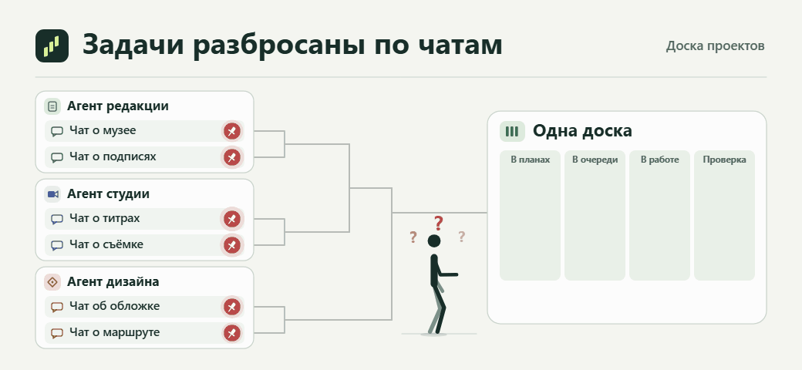

# Доска проектов

[English](README.en.md) · [Руководство](docs/guide.ru.md)

Локальная канбан-доска для задач из чатов. Доска ищет поручения в истории Codex и принимает задачи от подключённых ассистентов. В карточке можно сохранить описание и ссылку на исходный разговор.

[Скачать для Windows, macOS и Linux](https://github.com/Des0l/project-board/releases/latest) · [Попробовать на примере](#попробовать-на-примере)

## Открыть доску

Распакуйте архив для своей системы в папку, куда можно записывать файлы.

| Система | Запуск |
| --- | --- |
| Windows | Откройте `ProjectBoard.exe` или `Open-board.cmd`. |
| macOS | Откройте `Open-board.command` в Finder. |
| Linux | Выполните `sh Open-board.sh` из папки приложения. |

Для запуска из исходников нужен Node.js 22.13 или новее. Выполните `npm run open` из корня репозитория. [Подробности установки](docs/guide.ru.md#открыть-доску)

Доска поддерживает русский и английский. По умолчанию она использует язык системы. Чтобы выбрать язык вручную, откройте настройки (значок рядом со списком проектов) и выберите **Язык интерфейса**.

## Попробовать на примере

Выполните `npm run demo` из исходников. Из распакованного архива выполните `.\Open-board.cmd --demo` в Windows или `sh Open-board.sh --demo` в macOS и Linux. Откройте [«Неразобранные задачи»](http://127.0.0.1:4180/#inbox), найдите «Уточнить часы работы музея» и нажмите **«Добавить на доску»**. В созданной карточке будет описание с деталями поручения.

## Подключить свои чаты

- [Настроить папки проектов для Codex](docs/guide.ru.md#своя-доска)
- [Подключить другого ассистента](docs/guide.ru.md#подключить-другого-ассистента)
- [Установить плагин для Codex в приложении ChatGPT](docs/guide.ru.md#доска-в-приложении-chatgpt)

[Лицензия MIT](LICENSE)
