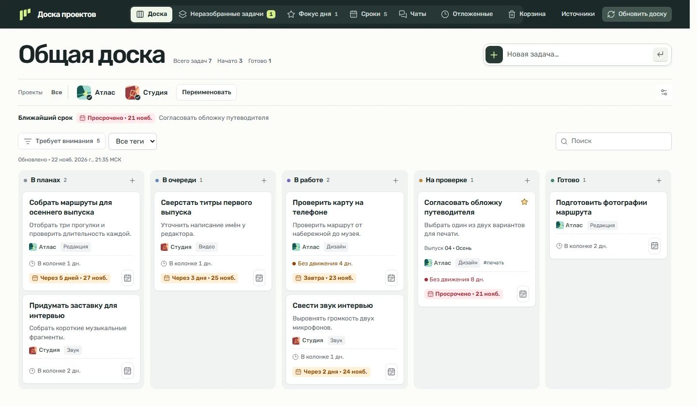

# Руководство по Доске проектов

[Главная](../README.md) · [English guide](guide.en.md)

## Первый запуск

В исходниках версии в разработке доска выбирает русский или английский по языку системы. В опубликованной сборке v0.13.0 интерфейс на русском. Чтобы сменить язык, откройте **Настройки доски → Язык интерфейса**. Пункт «Как в системе» возвращает автоматический выбор. Доска запоминает язык на этом устройстве. Названия проектов, задачи и переписка сохраняют исходный язык.

Подбор описания включён по умолчанию. Если в чате есть только название, поле остаётся пустым.

Из одного чата можно создать несколько карточек, а к одной карточке можно привязать несколько чатов проекта. Ответы открываются в карточке. Кнопка «Продолжить в чате» передаёт следующий шаг в основной чат.

Доска проверяет историю Codex при открытии и по кнопке «Обновить доску». Она ищет поручения на русском и английском. Например, при первом разборе переписки фраза «На будущее — уточнить часы работы музея» может стать предложением. Другие ассистенты отправляют задачи через локальную команду или HTTP API. См. [инструкцию по подключению](#подключить-другого-ассистента).

Подключённый ассистент может [подготовить по одному следующему шагу для выбранных проектов](#подготовить-несколько-проектов-к-релизу).

**Запуск из исходников** с Node.js 22.13+

```sh
npm run open
```

Команда откроет доску в браузере. Чтобы подключить свои чаты, [укажите папки проектов](#своя-доска). Также можно [скачать готовую сборку](#открыть-доску) или [запустить пример с карточками](#попробовать-на-примере).

## Открыть доску

Скачайте архив для своей системы в разделе [Releases](https://github.com/Des0l/project-board/releases/latest) и распакуйте его в папку, куда можно записывать файлы. В сборку уже входят Node.js и SQLite. Выберите `x64` для Intel и AMD или `arm64` для Apple Silicon и других процессоров ARM.

| Система | Как запустить из распакованной папки |
|---|---|
| Windows | Дважды щёлкните `ProjectBoard.exe` в распакованной сборке. В окне приложения появится доска. Если встроенная страница не загрузилась, нажмите «Открыть в браузере». Через `Open-board.cmd` доску также можно открыть в браузере по умолчанию. |
| macOS | Дважды щёлкните `Open-board.command` в Finder. |
| Linux | Выполните `sh Open-board.sh` в терминале из папки доски. Для ярлыка в меню приложений выполните `sh Open-board.sh --install-shortcut`. |

При первом запуске доска создаёт базу `data/board.sqlite` и открывается по адресу [127.0.0.1:4178](http://127.0.0.1:4178/). Если на этом порте уже работает ваша доска, новая распакованная копия без собственной базы и настроек откроет её. Путь к базе сохранится в `board-location.local.json`, чтобы тот же EXE мог открыть её после перезагрузки. При обновлении сохраните папку с базой. Для двух независимых досок задайте второй копии свои `PROJECT_BOARD_DATA` и `PROJECT_BOARD_PORT`.

Сборки рассчитаны на Windows 10 и новее, macOS 13.5 и новее и настольные дистрибутивы Linux с glibc 2.28 и новее. На Linux для открытия браузера используется `xdg-open`. Локальный адрес также выводится в терминал. [Платформы Node.js](https://github.com/nodejs/node/blob/v24.22.3/BUILDING.md#platform-list)

## Доска в приложении ChatGPT

ChatGPT для компьютера позволяет открыть режим Codex. Чтобы управлять этой доской из чата Codex, установите локальный плагин «Доска проектов». Команда `codex` должна быть доступна в PATH. В Windows запустите `Connect-ChatGPT.cmd`. На macOS и Linux выполните `sh Open-board.sh --install-plugin` из папки доски. Установщик связывает плагин с этой копией доски, её портом и базой. После перемещения приложения установите плагин заново.

В приложении ChatGPT переключитесь на Codex и в новом чате выберите плагин «Доска проектов». Например, попросите «Покажи задачи проекта „Атлас“» или «Переведи карточку №12 в работу». Плагин читает проекты и карточки, добавляет задачи и меняет поля карточек. Если сервер доски остановлен, плагин запускает его при обращении. Изменения появятся при возврате к доске. [Плагины в ChatGPT и Codex](https://help.openai.com/en/articles/20001256-plugins-in-chatgpt)

## Перенос на другой компьютер

В разделе **«Источники»** нажмите **«Сохранить копию»**. Доска покажет папку со снимком базы SQLite и файлом настроек проектов, если вы им пользовались. Сделать такую копию из терминала можно командой `Open-board.cmd --backup` в Windows или `sh Open-board.sh --backup` в macOS и Linux.

Распакуйте сборку на другом компьютере. До первого запуска создайте в папке приложения каталог `data` и скопируйте туда содержимое резервной копии. Если папки проектов переехали, обновите абсолютные пути в `projects.local.json` и сохраните прежние ID проектов. Вместе с базой переедут карточки, статусы, настройки и связи с чатами. Чтобы продолжить разговор, исходный чат должен быть доступен в локальном клиенте агента. Выбранные теги фильтра хранятся в браузере.

## Попробовать на примере

В примере два вымышленных проекта и семь карточек. Данные примера лежат в `data/demo/`, отдельно от вашей доски. Из исходников выполните `npm run demo` и откройте [«Неразобранные задачи»](http://127.0.0.1:4180/#inbox). Из переносимой сборки выполните `.\Open-board.cmd --demo` в Windows или `sh Open-board.sh --demo` в macOS и Linux.

Для предложения «Уточнить часы работы музея» выберите колонку «В работе» и нажмите «Добавить на доску». Вернитесь на вкладку «Доска» и откройте карточку. В ней будут детали поручения и строка с источником «Чат редакции».



## От переписки до карточки

1. Откройте доску или нажмите **«Обновить доску»**. Для подключённых проектов Codex проверит доступные чаты. Другие ассистенты могут присылать предложения через команду или локальный HTTP API.
2. Откройте **«Неразобранные задачи»**. Число на вкладке включает предложения, чаты без проекта и готовые черновики описаний по всем проектам. Внутри они сгруппированы по проектам. Если список урезан фильтром, нажмите «Показать все проекты». В предложении из Codex название чата ведёт к исходному разговору.
3. Нажмите **«Добавить на доску»**. По умолчанию карточка попадёт в «В планах». Можно выбрать другую колонку перед добавлением. Нажмите **«Пропустить»**, чтобы убрать предложение. Доска запомнит ваш выбор. Уже созданные карточки можно найти по названию.
4. Если в одном чате обсуждали несколько поручений, заведите отдельную карточку для каждого. Если одна задача обсуждалась в нескольких чатах проекта, откройте её карточку, укажите **«Основной чат Codex»**, раскройте **«Другие чаты этой задачи»** и сохраните выбор. Например, одну карточку «Проверить карту на телефоне» можно связать и с обсуждением дизайна, и с разбором результатов проверки.
5. Когда у карточки появится отметка **«Новый ответ»**, откройте её и нажмите «Показать ответ». Чтобы продолжить работу, запишите следующий шаг и нажмите «Продолжить в чате». При нескольких связанных чатах доска отправит его в основной.

## Своя доска

У каждого проекта есть цветная точка. Доска автоматически подбирает свободный цвет. Чтобы выбрать свой, откройте **«Настройки проекта»**, выберите проект и нажмите на образец **«Цвет проекта»**. Цвет хранится в локальной базе и сохраняется при переименовании и восстановлении проекта из корзины.

Нажмите **«Проекты»** и отметьте те, с которыми хотите работать. На доске появятся их теги и задачи. Нажмите название проекта или цветную точку на теге, чтобы открыть настройки. Крестик на теге скрывает проект. Его также можно скрыть и вернуть галочкой в списке. Браузер запоминает выбор. На узком экране ленту тегов можно прокрутить вбок.

Кнопка **«+ Проект»** рядом с фильтрами создаёт проект на доске. В него можно сразу добавлять задачи. Если несколько чатов из одной папки относятся к разным проектам, откройте **«Переименовать» → «Распределить чаты по проектам»**. Отметьте нужные чаты и выберите существующий проект или создайте новый. Во вкладке «Чаты» есть кнопка «Перенести чат» для отдельной переписки.

Доска запоминает выбор при синхронизации. Переписки и их рабочие папки в Codex остаются на месте. Карточка с несколькими чатами следует за своим основным чатом и сохраняет остальные связи. Предложения и вопросы переходят вместе с чатом-источником.

Чтобы исключить один или несколько чатов, отметьте их в окне «Распределить чаты» и нажмите **«Удалить с доски»**. Доска сохранит их ID в SQLite и будет пропускать их при проверках, в том числе после перезапуска. Переписки в Codex и уже созданные карточки сохраняются. Чтобы вернуть чат в проект и снова проверять его, нажмите «Восстановить» в корзине.

Когда в проекте больше нет чатов, карточек, предложений и открытых вопросов, доска предлагает **«Убрать проект с доски»**. Для пустого проекта эта кнопка есть и в настройках. Проект остаётся в корзине после синхронизации и перезапуска.

Если в папке удалённого проекта появится новый чат, ищите его в **«Неразобранные задачи» → «Чаты без проекта»**. Кнопка **«Выбрать проект»** переносит чат в новый или существующий проект. При следующей синхронизации доска проверит его по настройкам этого проекта. «Пропустить» убирает чат из очереди, а «Восстановить» в корзине возвращает его на разбор. Ранее распределённые чаты продолжают обновляться в своих проектах.

Для связи с чатами нужен установленный и настроенный Codex CLI. При первом запуске задайте папку проекта в `PROJECT_BOARD_ROOT` или перечислите несколько проектов в локальном JSON-файле. Без этих настроек первый проект соответствует папке приложения. Для работы только с ручными карточками задайте `PROJECT_BOARD_OFFLINE=1`.

**Как доска рекомендует проект.** При синхронизации доска запускает модель через текущую учётную запись Codex CLI. Она отправляет заголовки новых чатов без проекта и названия активных проектов. Для каждого проекта в запрос попадает до десяти тем и до четырёх заголовков распределённых чатов. В первую очередь доска берёт примеры, которые вы перенесли вручную. Текст сообщений в запрос не входит.

Доска запускает `codex exec --ephemeral --ignore-user-config` со стандартным провайдером Codex. Подбор расходует лимит модели. Чтобы синхронизировать чаты и выбирать проекты вручную, перед запуском задайте `PROJECT_BOARD_AI_ROUTING=0`.

Доска кратко объясняет, почему предложила проект. Кнопка «Перенести в …» принимает рекомендацию, «Выбрать другой» открывает список проектов. Выбрать проект вручную можно и тогда, когда модель не смогла предложить вариант. Доска хранит рекомендации в SQLite и использует их повторно, пока исходные данные те же. Если запрос завершился ошибкой, нажмите «Обновить доску», чтобы повторить его.

Пример файла `projects.local.json` для Windows:

```json
{
  "projects": [
    { "id": "studio", "name": "Студия", "roots": ["D:/Projects/studio"], "topics": ["Видео", "Звук"] },
    { "id": "atlas", "name": "Атлас", "roots": ["D:/Projects/atlas"], "topics": ["Редакция"] }
  ]
}
```

Подставьте абсолютные пути к папкам на своём компьютере. Первая папка в `roots` становится основной рабочей папкой агента. Если чат открыт в её подпапке, агент продолжит работу в подпапке. Для чата из другой папки проекта или без сохранённого пути агент использует основную папку. На Linux учитывайте регистр букв. Запустите доску из PowerShell:

```powershell
$env:PROJECT_BOARD_PROJECTS = (Resolve-Path ./projects.local.json).Path
npm start
```

Откройте [свою доску](http://127.0.0.1:4178). На Windows её также можно запустить через `Open-board.cmd`. На macOS и Linux задайте переменную перед запуском, например `PROJECT_BOARD_ROOT="$PWD" npm start`. Чтобы подключить к существующей доске ещё один проект, добавьте в JSON запись с новым идентификатором и перезапустите сервер с тем же файлом настроек. Новые проекты будут проверены при следующем открытии или обновлении доски. Переключатели видимости, темы и настройки предложений существующих проектов сохраняются в SQLite.

## Как чаты взаимодействуют с карточками

- **Каталог проектов.** В новых проектах по умолчанию включено `projectTasks: true`. Доска проверяет все чаты проекта. При первой проверке она запоминает, откуда читать новые сообщения, и один раз ищет отложенные поручения в доступной переписке. Эти предложения помечены «Из переписки» и ведут в исходный чат. Если дата обсуждения известна, доска показывает её рядом. При следующих проверках доска ищет поручения в новых сообщениях, в том числе в чатах без карточек. За предложения с названием чата отвечает отдельный переключатель. Сохраните файл настроек в `data/projects.local.json` или укажите путь через `PROJECT_BOARD_PROJECTS`.
- **Первое подключение в режиме привязанных чатов.** Доска находит неархивные чаты в рабочих папках проекта и предлагает создать карточки. Любое предложение можно принять в выбранную колонку или пропустить. Решение сохраняется.
- **Последующие чаты.** При открытии страницы или по кнопке «Обновить доску» обновляется каталог всех проектов. Переключатель «Предлагать карточку для нового чата» управляет предложениями по следующим чатам. Каждый найденный чат также доступен в разделе «Чаты».
- **Новый ответ.** В привязанной карточке появляется отметка «Новый ответ». При первом импорте доска запоминает последний ответ, который уже есть в чате. Чтобы загрузить полный текст нового ответа, нажмите «Показать ответ». Доска запоминает отметку «Прочитано».
- **Продолжение работы.** Укажите следующий шаг и нажмите «Продолжить в чате». Доска передаст контекст карточки и запустит ответ в том же чате в режиме чтения. Перенос карточки меняет статус задачи. Пользовательские действия во внешних аккаунтах требуют отдельной интеграции.
- **Ручное управление.** Создавайте, редактируйте, удаляйте и восстанавливайте задачи. Удалённая автокарточка сохраняет связь с чатом, поэтому следующая синхронизация не добавит её повторно.

## Как из сообщения получается задача

Если в переписке есть подробности задачи, доска показывает их под заголовком в «Неразобранных задачах» и переносит в описание при добавлении карточки. Если описание пустое, нажмите **«Подтянуть из чата»** на карточке. Черновик откроется под названием задачи. Его можно отредактировать и сохранить кнопкой **«Сохранить»**. Фрагмент из чата также можно добавить к своему описанию.

Чтобы найти описания сразу для всех проектов, откройте **«Черновики описаний» → «Подтянуть для всех»**. Найденные тексты сохраняются в локальной базе после закрытия доски. Откройте их через **«Проверить черновики»** в «Неразобранных задачах». Кнопка доступна при любом фильтре проектов. «Оставить черновиком» сохраняет правки до следующего просмотра, «Сохранить в карточку» заполняет описание, «Пропустить» убирает черновик из очереди. Доска подбирает описания локально по истории. Другой ассистент может передать описание через `--description`.

Из фраз «Проверь титры», «Добавь задачу — проверить титры» и «Next step: Check subtitles» доска может сделать предложение. Форма создания задачи и команда `board.mjs add` сразу добавляют карточку.

При открытии браузер сразу показывает сохранённую доску. Сервер загружает список чатов и читает новые сообщения в тех привязанных чатах, где были изменения. Если две вкладки запустят проверку одновременно, сервер сделает один запрос к Codex. Кнопка «Обновить доску» проверяет все привязанные чаты. После 30 минут отсутствия доска проверит изменения один раз, когда вы вернётесь во вкладку. Между проверками история не опрашивается. Если ход ещё идёт, его результат появится при следующем обновлении.

Доска хранит позиции чтения в SQLite. При первом обходе она запоминает, откуда читать новые сообщения, и отдельно ищет отложенные задачи в доступной истории. Если Codex утратит прежнюю позицию, в «Источниках» появится дата разрыва.

Доска ищет явные поручения, чек-листы и отмеченные следующие шаги по русским и английским формулировкам. Она пропускает благодарности, цитаты, вывод инструментов и обычные ответы. Если в том же ходе прямо сказано, что действие уже выполнено, доска снимает неявное предложение. В базе остаются заголовок, найденное описание, источник, решение пользователя и позиция чтения. Сильно перефразированные поручения иногда приходится разбирать вручную.

Доска узнаёт повторное событие по ID проекта, источника, чата и события. Она также сверяет название с карточками, корзиной и прежними решениями в этом проекте. Например, «Проверь титры» и «Проверить титры» считаются одной задачей. Если это поручение найдено в нескольких чатах проекта, доска собирает источники в одной карточке.

В одном чате может быть несколько задач. К карточке можно привязать несколько чатов проекта. Выберите основной чат для продолжения работы, а остальные добавьте через «Другие чаты этой задачи». Ответы и отметки прочтения хранятся для каждого чата отдельно. После пропуска предложения можно создать карточку вручную или вызвать `add` с новым событием.

## Подготовить несколько проектов к релизу

Подключите к чату [скилл доски](../skills/project-board/SKILL.md) по инструкции в настройках проекта. В запросе назовите нужные проекты. Например:

> Из десяти проектов хочу первыми выпустить «Атлас», «Студию» и «Каталог». Посмотри, что мешает каждому релизу. Добавь по одной задаче с ближайшим шагом и напиши, как проверить результат. Если подходящая карточка уже есть, дай её номер.

Ассистент смотрит карточки и блокеры выбранных проектов и сверяет их с доступными материалами. Если выпуск «Атласа» ждёт проверки расписания, ассистент может создать карточку «Сверить расписание для выпуска» и записать следующий шаг: «Сопоставить три маршрута с расписанием редактора. Готово, когда время совпадает по всем трём». Если причина задержки неизвестна, ассистент спросит, каких сведений не хватает. Карточки попадают в «В планах». Чтобы сначала просмотреть предложения в «Неразобранных задачах», попросите «предложи».

Когда выполните задачу, обновите её статус и попросите ассистента проверить, что ещё осталось до выпуска. Выбор проектов действует на этот запрос. Теги в браузере меняют только то, какие карточки видны на экране.

## Подключить другого ассистента

Нажмите **Настройки** и выберите проект. В разделе **Другие ассистенты → Подключить другого ассистента** выберите язык инструкции и скопируйте её в чат, который может выполнять локальные команды. По умолчанию инструкция использует язык интерфейса. Можно отдельно выбрать русский или английский. В инструкции есть путь к скиллу, команда доски, порт и ID проекта. Так можно подключить Claude Code, Kimi Code или адаптер, которому доступен локальный HTTP. Подключение действует в клиенте, которому вы передали инструкцию.

Команды ниже выполняются в папке доски. Порт по умолчанию — 4178. Если вы запустили отдельный пример, добавьте к команде `--port 4180`.

```sh
node board.mjs projects
node board.mjs suggest --project studio --provider my-assistant --session edit-12 --event m24-1 --description "Фамилии сверить с финальными титрами фильма." "Проверить титры"
node board.mjs add --project studio --provider my-assistant --session edit-12 --event m25-1 "Подготовить обложку"
node board.mjs context --project studio --provider my-assistant --session edit-12
```

В `add` и `suggest` можно передать `--next "Что сделать и как проверить результат"` (до 1000 символов). Через HTTP этому параметру соответствует необязательное поле `next`. Следующий шаг сохраняется при создании карточки. Если такая карточка уже есть, сохраняются её текущие поля и статус.

Когда возвращаетесь к работе, ассистент может вызвать `context`. Команда возвращает номер и название карточки, статус, описание, следующий шаг, блокер, теги, своё поле, отметку корзины и решения по предложениям. Чтобы получить состояние всего проекта, опустите `--provider` и `--session`. При повторной отправке указывайте тот же ID события. Для двух задач из одной реплики передайте разные ID, например `m24-1` и `m24-2`. Если опустить `--event`, доска вычислит его из команды и заголовка. Название задачи можно передать на любом языке.

Кнопка «Источники» показывает результат последней проверки Codex, недоступные чаты и ассистентов, которые передавали задачи или запрашивали карточки. При перемещении карточки новый статус сохраняется на доске. Ассистент получит его при следующем запросе состояния. Для запуска в привязанном чате Codex служит кнопка «Продолжить в чате».

Адаптер может обращаться к локальному серверу. Чтобы получить список проектов, отправьте `GET /api/bridge/projects`. Для состояния проекта используйте `GET /api/bridge/context?project=studio`. Чтобы отфильтровать карточки по чату, добавьте `provider` и `session`. Для записи отправьте `POST /api/bridge/tasks` с заголовками `Content-Type: application/json` и `X-Board-Action: 1`.

```json
{"projectId":"studio","mode":"suggest","title":"Проверить титры","source":{"provider":"my-assistant","session":"edit-12","event":"m24-1"}}
```

Доска возвращает решение `pending`, `added` или `dismissed`. Для принятой задачи в ответ входит актуальная карточка. При обновлении доска читает изменения в привязанных чатах Codex. Другие клиенты присылают события и запрашивают состояние через команду или HTTP. Облачному клиенту нужен посредник, который может обратиться к доске.

После проверки в «Источниках» видно, сколько чатов доска разобрала. Доска учитывает явные отложенные поручения и TODO в завершённых ходах, следующие шаги из трёх последних завершённых ходов и распознанные сообщения о выполнении. Примите предложение в нужную колонку или пропустите его. При повторной находке доска учтёт прежнее решение.

## Названия проектов

При синхронизации доска предлагает заменить типовые имена вроде «New project 2» и «Новый проект». Кнопка «Переименовать» рядом с фильтрами доступна для любого проекта. В форме видны исходные чаты и, когда их названия указывают на общую тему, вариант нового названия. «Оставить название» запоминает выбор. История названий хранит прежнее имя, время и чаты, показанные при переименовании. Карточки, фильтры и синхронизация используют постоянный идентификатор проекта.

## Текущая работа

**Отложить до даты.** Нажмите значок календаря на карточке или перетащите её на «Отложить до…». В «Неразобранных задачах» можно отложить предложение сразу или открыть через «Посмотреть». Укажите дату и выберите, что отложить: одну задачу или весь проект. Если отложить проект, новые карточки и предложения также попадут в «Отложенные».

Во вкладке **«Отложенные»** можно посмотреть список и вернуть нужное раньше. В выбранную дату по Москве карточки вернутся в свои колонки, предложения появятся в «Неразобранных задачах». Дедлайны остаются видны в «Сроках». Если вернуть проект раньше, отдельно отложенные задачи сохранят свои даты.

**Ждут вашего ответа.** Если локальный клиент Codex сообщает, что ждёт ввода или разрешения, при обновлении доска покажет отметку со ссылкой на чат. Список и даты отражают последнюю синхронизацию. Подключённый ассистент может отправить вопрос через `ask` и снять его командой `answered` с тем же ID события. На доске эту отметку снимает кнопка «Уже ответил». Для вопросов из ChatGPT нужен адаптер.

```sh
node board.mjs ask --project studio --provider my-assistant --session edit-12 --event subtitles-format "Какой формат субтитров нужен?"
node board.mjs answered --project studio --provider my-assistant --session edit-12 --event subtitles-format
```

**Срок задачи.** Дату можно оставить пустой. За семь календарных дней до срока на карточке появляется оранжевая отметка. При появлении значок календаря пульсирует. Если в системе включено уменьшение движения, значок стоит на месте. В день срока доска показывает «Срок сегодня», после него отмечает карточку красным «Просрочено». Задачи с ближайшими и прошедшими сроками можно найти через фильтр «Требует внимания». В колонке «Готово» дата остаётся для справки. Чтобы снять срок, очистите поле в карточке и сохраните её.

Введите название в поле «Новая задача…» и нажмите Enter. Если выбран один проект, доска сразу создаст в нём задачу. Если проектов несколько, откроется форма с введённым названием и выбором проекта. Плюс слева открывает полную форму, где можно указать срок, тему и связанный чат.

На карточке видны следующий шаг или описание, срок и время в колонке. После трёх полных дней в работе или на проверке появляется оранжевая отметка, после семи дней она становится красной. Если дату перехода старой карточки восстановить нельзя, доска показывает, сколько прошло с начала наблюдения за карточкой в этой колонке. Фокус дня и границы сроков рассчитываются по Москве.

На телефоне нажмите «Проекты», чтобы раскрыть теги. Число на кнопке показывает, сколько проектов выбрано. Можно включать и скрывать проекты по одному, а кнопка «Все» переключает весь список. Выбранные проекты отмечены галочкой. Один и тот же выбор действует на доске, в сроках, фокусе, чатах и корзине. Браузер запоминает его после перезагрузки.

У каждой задачи есть свои теги и одно текстовое поле проекта. Укажите теги через запятую в карточке. Над колонками появится фильтр, а общий поиск найдёт и тег, и значение поля. В настройках проекта поле можно переименовать, например в «Площадка». Уже введённые значения сохраняются.

## Возвращение после перерыва

SQLite хранит карточки, теги, связи с чатами, решения по предложениям, последний отчёт и позиции чтения. Доска сохраняет изменения из чата и новую позицию одной транзакцией. Если компьютер выключится во время проверки, следующая проверка продолжится с последней сохранённой позиции. После перезапуска сервер проверит чаты, когда вы откроете доску или запустите проверку вручную. Время последней проверки каталога показано по Москве.

Если Codex не может открыть предысторию ветки, доска читает локальный журнал этого чата. При первом проходе она запоминает позицию и последний завершённый ответ. Дальше читает только добавленные сообщения, а незавершённый ход дочитывает при следующем обновлении. В «Источниках» видно, для каких чатов используется журнал. Для работы с карточками достаточно локальной базы. Пока доска закрыта, историю хранит Codex.

## Данные и разработка

**Кто может читать и менять доску.** Сервер принимает соединения на `127.0.0.1`. Любая программа, которой доступен этот порт, может через API прочитать карточки, изменить задачи или запросить запуск агента для привязанного чата. На общем компьютере такой доступ может быть и у программ других пользователей. Доска не запрашивает пароль или токен. Для запросов из браузера сервер проверяет источник при записи и требует специальный заголовок. Локальная программа может сама отправить этот заголовок.

`data/board.sqlite` содержит личную доску. Путь можно изменить переменной `PROJECT_BOARD_DATA`, порт — `PROJECT_BOARD_PORT`. База, настройки с локальными путями, резервные копии, журналы и личные проектные заметки исключены из Git. Список распространяемых файлов задан в `package.json`.

```sh
npm test
npm pack --dry-run
```

GitHub Actions запускает тесты на Windows, macOS и Linux. Браузерная проверка сроков работает с отдельной временной базой. Чтобы повторить её локально, установите Python и выполните:

```sh
python -m pip install playwright==1.62.0
python -m playwright install chromium
python scripts/check-deadlines.py
```

Для сборки переносимых архивов нужны Python 3.11+ и npm. Запустите `python scripts/pack-portable.py` из корня репозитория. Шесть архивов появятся в `release/`. Чтобы собрать только Windows x64, выполните `python scripts/pack-portable.py win-x64`. Скрипт загружает официальные дистрибутивы Node.js, сверяет их SHA-256 и кладёт в архив бинарный файл и лицензию.

Сервер и HTTP API находятся в `server.mjs`, модель SQLite и правила импорта в `lib/model.mjs`, адаптер Codex app-server в `lib/codex.mjs`. Интерфейс лежит в `public/`. Шрифты, компоненты и их лицензии есть в `public/vendor/`. Разметка подробных карточек основана на [Kanban Board на 21st.dev](https://21st.dev/@uvain/components/kanban-board). Для счётчиков колонок используется [NumberFlow](https://number-flow.barvian.me/vanilla), для пиктограмм — [Lucide](https://lucide.dev/).

## Лицензия

Код доски распространяется под [лицензией MIT](../LICENSE). У шрифтов, пиктограмм и компонентов свои лицензии в [public/vendor](../public/vendor). В переносимых сборках лицензия Node.js находится в `runtime/LICENSE`.
